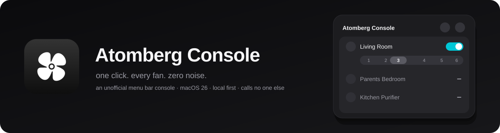

<p align="center">
  
</p>

<p align="center">
  <a href="https://github.com/ashwingopalsamy/atomberg-console/actions/workflows/ci.yml"></a>
  
  
  
  
  <a href="LICENSE"></a>
</p>

<p align="center">
  an unofficial menu bar console for <b>Atomberg</b> fans, purifiers and locks.<br>
  local first · 100-call budget respected · talks to nobody else
</p>

---

## why

Atomberg's app is a phone app. This one lives in your menu bar: see every device, change a speed, check a
battery, without picking anything up. When a fan is on your Wi‑Fi it is controlled directly, and costs nothing
from the **100 cloud calls a day** the developer API allows.

## what you get

| | |
|---|---|
| **Menu bar count** | the fan glyph, plus how many fans are running |
| **Speed on the row** | a running fan carries its own six-step control, no detail screen needed |
| **Local first** | `wifi` or `cloud` on every row says how it is reached; one tap re-checks your network |
| **Honest budget** | a refresh is 1 call, a command 0 or 1, usage figures once a day. Counted, and logged |
| **Readable at a glance** | offline, low battery and faults are symbols, not paragraphs |
| **Small** | one popover, a settings pane, an FAQ. No windows to manage |

## calls no one

<p align="center"></p>

One cloud host, two UDP ports, no dependencies, no analytics, no updater. That is enforced in code
(`NetworkPolicy`), checked in CI (`scripts/check-egress.sh`), and verifiable on your own Mac in three commands:
see [docs/PRIVACY.md](docs/PRIVACY.md).

## the budget

<p align="center"></p>

Every cloud request is one line in `~/Library/Application Support/ATOMBERG/calls.log` (method, path, status; no
secrets). If something costs a call, you can see which.

## install

**Homebrew**

```sh
brew install --cask ashwingopalsamy/tap/atomberg-console
```

**DMG** → [latest release](https://github.com/ashwingopalsamy/atomberg-console/releases/latest). Verify it:

```sh
shasum -a 256 -c Atomberg-Console-*.dmg.sha256
gh attestation verify Atomberg-Console-*.dmg -R ashwingopalsamy/atomberg-console
```

**Source** (nothing to trust but the code)

```sh
git clone https://github.com/ashwingopalsamy/atomberg-console && cd atomberg-console
scripts/bundle.sh && open "build/Atomberg Console.app"
```

> The app is not notarised: that needs a paid Apple Developer membership. macOS will ask once. Right-click →
> Open, or `xattr -dr com.apple.quarantine "/Applications/Atomberg Console.app"`.

## first run

1. In the Atomberg Home app, turn on **Developer Mode** and copy the API key and refresh token.
2. Open Atomberg Console and paste both. They go to your Keychain and nowhere else.
3. Allow Local Network access when macOS asks. That is what makes fans free to control.

<details>
<summary><b>faq</b></summary>

**Why does a command sometimes use a cloud call?**
When a fan is not heard on your Wi‑Fi. Same network, Local Network access on, then tap the wifi button.

**Is it safe to give it my API key?**
It is stored in the macOS Keychain and only ever sent to `api.developer.atomberg-iot.com`. The code is small
enough to read in an evening.

**Does it work without local control?**
Yes. It just spends a call per command.

**Which devices?**
Whatever your developer account lists: fans over local network and cloud, purifiers and locks over the cloud.

</details>

## contributing

Small pull requests, conventional commits, no new network destinations without a discussion first. See
[CONTRIBUTING.md](CONTRIBUTING.md) and [SECURITY.md](SECURITY.md).

---

<sub>Unofficial. Not affiliated with, endorsed by or supported by Atomberg. The name and logo belong to their
owners. Source-available under [PolyForm Noncommercial 1.0.0](LICENSE): free for noncommercial use.
[Notice](NOTICE.md) · [Privacy](docs/PRIVACY.md) · [Design](docs/DESIGN.md) · [Changelog](CHANGELOG.md)</sub>
